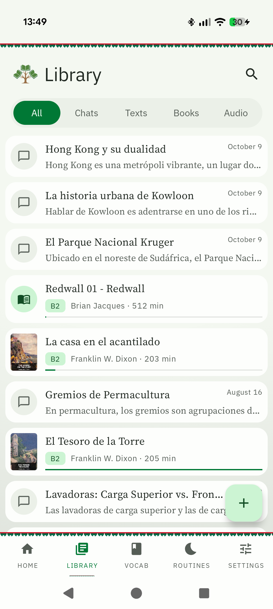
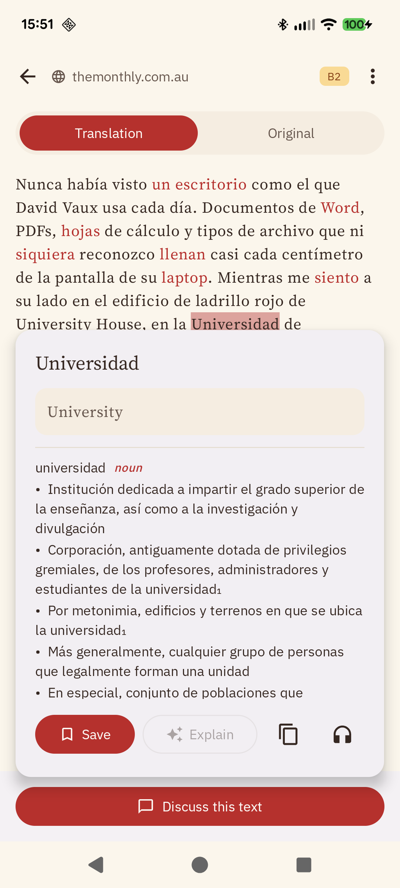
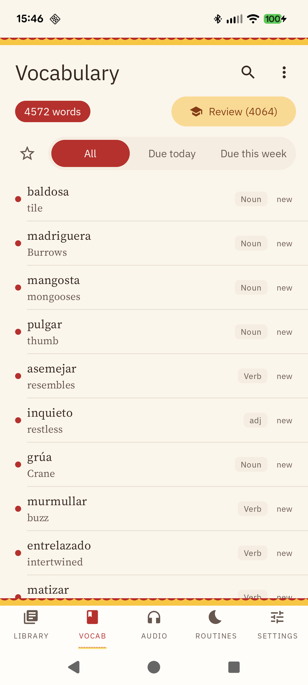
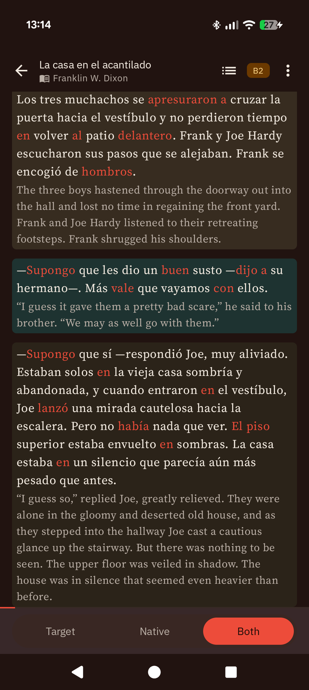
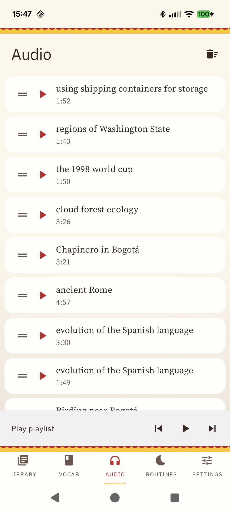
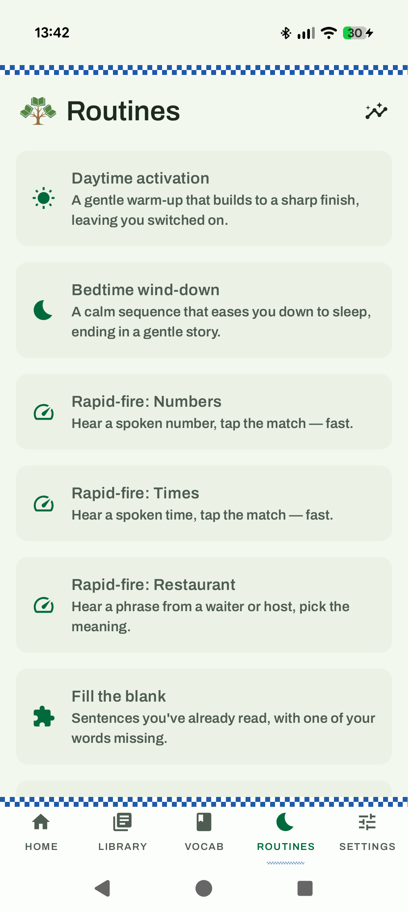

<p align="center">
  <picture>
    <source media="(prefers-color-scheme: dark)"
            srcset="app/src/main/res/drawable-xxxhdpi/ic_logo_dark.png">
    
  </picture>
</p>
<h1 align="center">Copiosa</h1>
<p align="center"><em>Spanish for "abundant." Bring one API key; everything else is included.</em></p>

Copiosa is an Android app for learning a language as an adult.

You chat with an AI tutor in the language you're learning. You paste in an article, or import an
EPUB, and read it with a translation beside it. Tap any word you don't know and it tells you what it
means — tap again and it becomes a flashcard. Those flashcards come back on a proper
spaced-repetition schedule. When you'd rather be taught than immersed, short grammar courses start
from zero. At night, the app builds you a short wind-down routine out of whatever you've been
studying.

You bring one API key. There's no account, no subscription, and no server: your vocabulary, your
reading, and your progress live on your phone.

## What it does

- **Conversations.** Chat with a tutor pitched at your level and themed by country and persona.
  Replies quietly recycle vocabulary you're due to review and suggest where to take the conversation
  next. You can also batch-generate a shelf of conversations on topics you pick, to read like graded
  readers.
- **Articles and texts.** Paste a URL or any text — or share an article straight from your browser
  into Copiosa — and get a clean, chunked translation that survives being interrupted.
- **Books.** Import an EPUB and read it with a Target / Native / Both toggle, its tables, footnotes
  and images intact. A book already in your target language is readable the moment it lands and can
  cost no API calls at all. For the rest you choose, book by book, how eagerly it translates: only
  as you read, quietly in the background, or the whole novel in one run. Any book exports back out
  as an EPUB, either a clean copy in the language you're learning or a bilingual one with each
  paragraph followed by its translation.
- **Tap to define.** Tap a word or drag across a phrase for an instant definition and translation,
  from a fully offline dictionary and on-device translation. One more tap saves it as a flashcard —
  and words you've saved stay highlighted everywhere you read.
- **Vocabulary.** A real FSRS scheduler with cloze cards, images, audio, and one-tap undo. Every
  word is learned in both directions, recognising it and producing it, each on its own schedule.
  Anki `.apkg` decks move in and out losslessly, review history included, and a plain JSON export
  lets you edit cards in bulk outside the app and merge them back. Words you merely *meet* while
  reading earn quiet passive credit. A word that keeps slipping is pointed out, never frozen for
  you, and every card shows its review history and can be rescheduled or started over by hand.
- **The commonest words first.** The 2,000 most frequent words of Spanish and Portuguese are built
  in. See how much of that list your deck covers, drill the most frequent words you have, and let
  the app fill the gaps a few at a time.
- **Grammar courses.** Authored courses that teach one grammar point from zero, then hand what you
  learned to the scheduler. Spanish ships four: the preterite, the imperfect, choosing between the
  two, and *por* against *para*. Lessons introduce a couple of forms at a time and spend most of
  their length on practice.
- **Cloze bank.** Fill-in-the-blank practice built from sentences you already own: the pages of
  your books you've actually read, your texts and chats, the dictionary's examples and your cards'
  own. A sitting is made of the words you most need right now — the ones you missed today, the ones
  that keep slipping, the ones coming due — and the mining happens on the phone and costs nothing.
  Pick the word from four, type it, hear the sentence before you see it, fill several gaps in a
  passage you've read, or walk the 2,000 commonest words in order. The bank also makes a hands-free
  radio track: sentence, meaning, sentence again.
- **Listen anywhere.** Turn any conversation, text, or selection into a playlist item spoken by a
  neural voice running on the phone itself. A whole book becomes a folder of chapter tracks.
  Background playback, per-item voices, adjustable speed.
- **Drills.** Rapid-fire listening for the things that only come with reps — numbers, clock times,
  restaurant phrases. Listen-and-rebuild, where you hear a sentence and tap its shuffled words back
  into order before you see it written. And a conjugation drill for Spanish and European
  Portuguese. Rapid-fire and conjugation speed up as you improve.
- **Reference.** Full conjugation tables and a guide to what each tense and mood is for, one tap
  from the drill that just stumped you.
- **Routines.** A nightly wind-down assembled from fifteen kinds of activity — review, grammar
  drills, cognate hunts, a serial story that continues night after night — arranged into a calming
  arc and tuned to what you're weakest at. A daytime routine runs the arc the other way, warming up
  gently and finishing sharp.
- **Home and progress.** What's due, a daily goal, time spent, accuracy, and streaks.
- **A look you'll want to open.** Country palettes, persona skins, dark mode, adjustable reading
  fonts — and per-language profiles that keep settings, decks, playlists and progress separate.

## Screenshots

| Conversations                             | Tap-to-define                                    | Vocabulary                                |
| ----------------------------------------- | ------------------------------------------------ | ----------------------------------------- |
|  |   |  |

| Reading                             | Audio playlist                                | Routines                            |
| ----------------------------------- | --------------------------------------------- | ----------------------------------- |
|  |  |  |

## Getting started

1. Build and install the app (see [Building](#building) below).
2. Open **Settings → Models** and paste a [Gemini](https://aistudio.google.com/apikey) or
   [OpenRouter](https://openrouter.ai/keys) API key. Nothing that talks to a model works until you
   do; everything else already does.
3. Open **Settings → Language** to pick the language you're learning.

Two extras download only if you ask for them: the neural voice (~100 MB, in **Settings → Models**)
and the offline dictionary pack for your language. Skip both and the app still works — you just lose
spoken audio and offline definitions.

## Private by design

- **Bring your own key.** Copiosa talks to Gemini or OpenRouter (and so to any model they route,
  including Claude and GPT) with *your* key. No backend, no account, no telemetry, no middleman.
  Settings keeps a running tally of what the month's calls have cost, by feature and by model.
- **Everything else runs on the phone.** Dictionary lookups, word-form resolution, translation of
  taps and selections, speech synthesis, scheduling, and the routine adaptation engine are all
  local. Airplane mode breaks nothing except generating new material.
- **Your data is a file.** One database plus media folders in app storage. Export your vocabulary as
  a standard Anki `.apkg` any time, or take a full backup — database, media, settings — as a single
  zip from Settings and restore it on another device.

## Why it works this way

Copiosa is unusually explicit about *why* each feature exists: spacing, retrieval practice,
desirable difficulties, dual coding, input processing, affective filters. The full tour of what's
implemented — and what isn't yet — is in **[docs/LEARNING_SCIENCE.md](docs/LEARNING_SCIENCE.md)**.

## Under the hood

Native Android, single Gradle module: Kotlin, Jetpack Compose + Material3, Hilt, Room, Retrofit,
Media3 for playback, ML Kit for on-device translation, and sherpa-onnx for on-device text-to-speech.
The technical map — layers, subsystems, data model, invariants, and how to extend the parts designed
for extension — is in **[ARCHITECTURE.md](ARCHITECTURE.md)**.

### Building

Requirements: Android Studio (or its JBR) with JDK 17, Android SDK 36 (compile/target SDK 36; runs
on Android 8.0+ / minSdk 26).

```powershell
# Windows (PowerShell); use ./gradlew on macOS/Linux
$env:JAVA_HOME = "C:\Program Files\Android\Android Studio\jbr"
.\gradlew.bat :app:assembleDebug
.\gradlew.bat :app:testDebugUnitTest
```

- The sherpa-onnx TTS AAR (~55 MB) is **downloaded automatically** by the `downloadSherpaOnnxAar`
  Gradle task on first build — no manual step.
- The offline dictionary packs (`dict_es.sqlite.gz`, `dict_pt.sqlite.gz`) are built by
  [tools/build_dictionary.py](tools/build_dictionary.py) from a [kaikki.org](https://kaikki.org)
  Wiktextract dump and downloaded in-app on demand — they are not in the repo.
- The User-Agent sent to Wikimedia Commons (flashcard image search) names a contact. It defaults to
  this project's URL; to send your own, add `copiosa.contact=you@example.com` to the gitignored
  `local.properties`. Nothing needs setting for a build to work.
- Language support: conversations, texts, books, flashcards, and audio work for any language your
  LLM speaks. The grammar courses are Spanish; the conjugation drill, frequency lists and offline
  dictionary cover Spanish and Portuguese; rapid-fire quizzes cover en/es/fr/de/it/pt.

### Status

Personal project, actively developed, pre-1.0. It is genuinely daily-driven by its author — expect
opinionated defaults and a Spanish-leaning feature set. Issues and ideas welcome; if you'd like to
contribute code, please open an issue to discuss it first.

### License

Copiosa is licensed under the [Apache License 2.0](LICENSE). Font licenses for the bundled typefaces
(all OFL) are in [licenses/](licenses/). The offline dictionary packs are built from
[Wiktextract](https://kaikki.org) data derived from Wiktionary, which is licensed CC BY-SA / GFDL —
they are downloaded data, separate from the app's own license.
